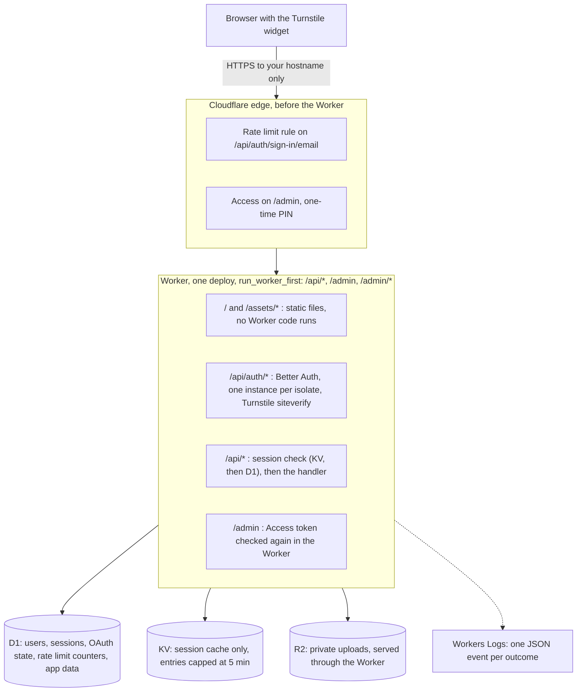

# Architecture

## A request, start to finish

1. The browser loads the app. Static files come straight from Cloudflare without running the Worker.
2. Sign-in sends the Turnstile token with the form. The Worker checks it with Cloudflare's siteverify API, which accepts a token once and for one hostname, then Better Auth checks the password and sets an HttpOnly, Secure, SameSite=Lax cookie.
3. Signed-in API calls read the session from KV and fall back to D1 on a miss. No session means 401 before any handler runs.
4. Google login ends with Google sending the browser to `/api/auth/callback/google`. That is a page navigation, so it reaches the Worker only because `/api/*` is in `run_worker_first`.

## Settings that decide whether this works

Each of these is set in this repo. Each was found by breaking it.

- **`run_worker_first` lists `/api/*` and `/admin`.** Without it, the single-page-app mode answers browser navigations with `index.html`, and Google login never completes.
- **One Better Auth instance per isolate** (`AUTH_INSTANCE=isolate`). Better Auth checks the database schema once per instance; building it on every request repeats that check on every request, which cost about 500 ms per request when the Worker ran far from the database.
- **KV as the session cache, with three settings around it.** Single-use values (OAuth state) and rate limit counters stay in D1, because KV has no atomic read-and-delete or counter. The KV store's `delete` logs and carries on, because Better Auth deletes from KV before D1 and a throwing delete would leave the session alive after sign-out. Entries are capped at 5 minutes, so a missed delete cannot keep a session alive longer than that.
- **Better Auth's `cookieCache` is off.** With it on, a signed-out cookie kept working for about 60 seconds.
- **workers.dev and preview URLs are off.** The zone's rate limit and Access do not apply there.
- **Access requires the one-time PIN login method**, not only the admin's email, and the Worker verifies the Access token itself.
- **Writes that carry a cookie must name this app** through Origin or Referer. Better Auth checks its own routes; the app checks its own.
- **Uploads must declare their length** and are capped, and the stored file type comes from the bytes, never the client's header.

## Free plan limits that apply

From Cloudflare's docs, checked while building this:

- Workers: 100,000 requests a day, 10 ms CPU per request. Sign-up and sign-in measured at p90 94 to 114 ms and p99 159 to 190 ms of CPU, and none were cut off at a few per minute. That is not a promise at volume.
- Rate limiting: one rule per zone, Path and Verified Bot fields only, 10-second window, Block only.
- D1: daily row read and write limits; queries fail past them until midnight UTC.
- Workers Logs: 200,000 events a day, kept 3 days. From 1 December 2026 the Free plan moves to 0.5 GB a day, kept 7 days.

## Measured latency

One browser in India, whose traffic reached Cloudflare at Marseille, with the D1 database in Asia-Pacific. 20 signed-in `GET /api/me` per setup, median.

| Setup | Session check | Round trip |
|---|---|---|
| Defaults: no KV, Better Auth built per request | 832 ms | 985 ms |
| KV cache, Better Auth built per request | 471 ms | 623 ms |
| No KV, schema check off | 306 ms | 445 ms |
| This repo: KV cache, one Better Auth instance per isolate | 3 ms | 127 ms |

Which Cloudflare location your users reach depends on their network. Design so a signed-in request needs no database query, and measure from where your users are: set `debug_timing = "on"` in Terraform to get `Server-Timing` headers.

Smart Placement did not move the Worker closer to the database at one request a second from one region over 18 minutes. Do not count on it at low volume.
